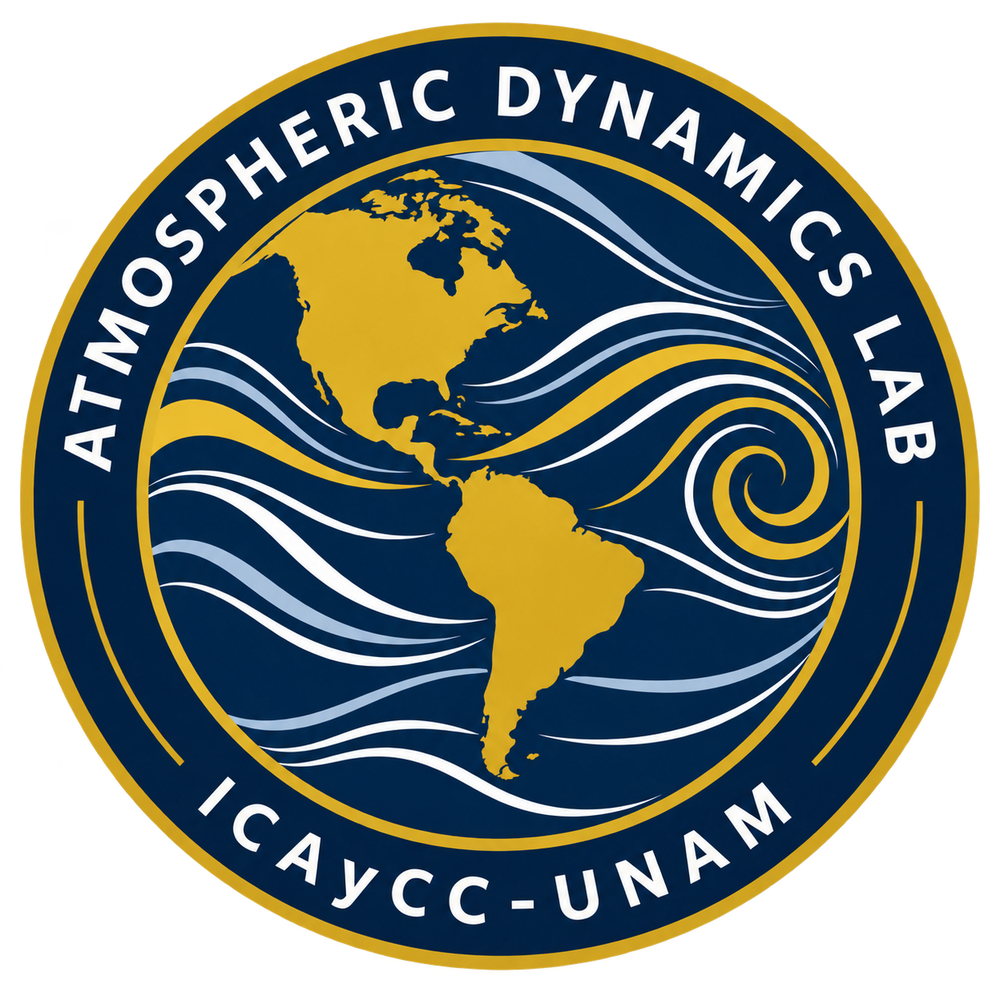

# Atmospheric Dynamics Lab

  

**Interactive Simulations for Teaching and Exploring Atmospheric Dynamics**

Atmospheric Dynamics Lab is an educational initiative dedicated to developing interactive, browser-based simulations that illustrate fundamental concepts and physical processes in atmospheric dynamics.

The project aims to provide students, educators, and anyone interested in atmospheric science with intuitive tools for exploring the mathematical and physical principles governing atmospheric motion.

Developed by **Alejandro Jaramillo Moreno**, Research Scientist at the Instituto de Ciencias de la Atmósfera y Cambio Climático (ICAyCC), Universidad Nacional Autónoma de México (UNAM).

---

## Overview

Atmospheric dynamics involves mathematical equations and physical concepts that can be challenging to visualize using traditional classroom methods.

Atmospheric Dynamics Lab addresses this challenge through interactive numerical and analytical demonstrations, allowing users to manipulate physical parameters and immediately observe how atmospheric systems respond.

The simulations are designed primarily to complement undergraduate and graduate courses in atmospheric dynamics, but they are freely accessible to anyone interested in learning about atmospheric motion.

## Objectives

The main objectives of Atmospheric Dynamics Lab are to:

- Develop interactive visualizations of fundamental atmospheric dynamics concepts.
- Connect mathematical formulations with their physical interpretations.
- Encourage experimentation through user-controlled parameters.
- Support classroom teaching and independent learning.
- Provide freely accessible educational resources that require no specialized software installation.

## Interactive Simulations

The laboratory will progressively incorporate simulations covering topics such as:

- **Atmospheric Forces and Balances:** Pressure-gradient force, Coriolis force, geostrophic balance, and inertial oscillations.
- **Atmospheric Waves:** Rossby waves, inertia-gravity waves, and wave propagation.
- **Vorticity and Circulation:** Relative and planetary vorticity, conservation principles, and atmospheric rotation.
- **Atmospheric Instabilities:** Fundamental mechanisms governing the growth and evolution of atmospheric disturbances.
- **Geophysical Fluid Dynamics:** Idealized representations of fluid motion and dynamical processes relevant to the atmosphere.

Each simulation will be accompanied by a brief theoretical explanation, adjustable physical parameters, and interactive visualizations.

## Technical Approach

Atmospheric Dynamics Lab is designed as a lightweight, browser-based educational platform using:

- **HTML and CSS** for the website structure and interface.
- **JavaScript** for numerical calculations, interactive controls, and animations.
- **GitHub Pages** for free and publicly accessible hosting.

Whenever possible, the mathematical formulations implemented in the simulations will be based on analytical solutions or simplified numerical models.

The platform is designed to operate directly in modern web browsers, without requiring users to install Python, Jupyter Notebook, or additional scientific software.

## Project Status

**Under active development.**

The initial development phase focuses on establishing the website and translating existing Python-based atmospheric dynamics demonstrations into interactive JavaScript applications.

Simulations and educational materials will be added progressively.

## Author

**Alejandro Jaramillo Moreno**  
Research Scientist  
Departamento de Cambio Climático  
Instituto de Ciencias de la Atmósfera y Cambio Climático (ICAyCC)  
Universidad Nacional Autónoma de México (UNAM)  
Mexico City, Mexico

- **Personal website:** [ajaramillomoreno.github.io](https://ajaramillomoreno.github.io/)
- **ORCID:** [0000-0002-4175-7726](https://orcid.org/0000-0002-4175-7726)
- **Email:** [ajaramillo@atmosfera.unam.mx](mailto:ajaramillo@atmosfera.unam.mx)

## Institutional Affiliation and Disclaimer

Atmospheric Dynamics Lab is an **independent educational initiative** developed by Alejandro Jaramillo Moreno as part of his broader interests in atmospheric science, scientific computing, and education.

The author is affiliated with the Instituto de Ciencias de la Atmósfera y Cambio Climático (ICAyCC) at the Universidad Nacional Autónoma de México (UNAM).

The project is not an official institutional platform or an officially endorsed product of ICAyCC or UNAM.

---

**Atmospheric Dynamics Lab — Explore atmospheric motion through interactive simulations.**